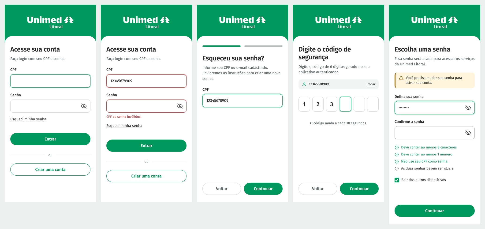

# Tema de login "unimed-litoral" (Keycloak 26.0.5)

Tema de login com a identidade visual da Unimed Litoral, baseado nas telas do app:
cabeçalho verde com logo, cartão branco arredondado, campos grandes, botões verdes em pílula,
links sublinhados, código de segurança em caixas e requisitos de senha com check.



## Estrutura

| Caminho | Para quê |
|---|---|
| `theme/unimed-litoral/login/` | Código do tema (templates FreeMarker, CSS, JS, mensagens, logo, fontes) |
| `META-INF/keycloak-themes.json` | Registro do tema para o empacotamento em JAR |
| `build.sh` | Gera `dist/unimed-litoral-keycloak-theme.jar` (precisa de JDK, comando `jar`) |
| `docs/previews/` | Capturas reais, geradas num Keycloak 26.0.5 local (celular 390px e desktop 1280px) |
| `teste-local/realm-teste.json` | Realm de teste usado nas capturas (usuários fictícios, só para ambiente local) |

## Gerar o JAR

```bash
./build.sh
```

## Telas personalizadas

| Tela do Keycloak | Arquivo | Equivale no app a |
|---|---|---|
| Login | `login.ftl` | "Acesse sua conta" (CPF, senha com olho, Esqueci minha senha, Entrar, ou, Criar uma conta) |
| Esqueci minha senha | `login-reset-password.ftl` | etapa 1 de 2, botões Voltar + Continuar |
| Nova senha / senha temporária | `login-update-password.ftl` | "Escolha uma senha" com requisitos marcados ao vivo |
| Código OTP (autenticador) | `login-otp.ftl` | "Digite o código de segurança" em 6 caixas |

Todas as outras telas (cadastro, verificar e-mail, erro, info, configurar OTP, WebAuthn etc.)
continuam vindo do tema padrão, mas passam pelo `template.ftl` e pelo CSS deste tema, então
herdam cabeçalho, cartão, campos e botões no mesmo estilo (ver `docs/previews/*-06-cadastro.png`).

## Instalação no servidor

> Não foi aplicado nada no servidor de homologação. Os passos abaixo são para você executar.

### Opção A: JAR em `providers/` (recomendado)

```bash
cp dist/unimed-litoral-keycloak-theme.jar /opt/keycloak/providers/
/opt/keycloak/bin/kc.sh build        # necessário só em modo "start" (produção) com build otimizado
# reinicie o Keycloak
```

Em Docker/Kubernetes, inclua o JAR na imagem (junto com o `keycloak-bcrypt`, que também fica em `providers/`):

```dockerfile
FROM quay.io/keycloak/keycloak:26.0.5
COPY keycloak-bcrypt-*.jar /opt/keycloak/providers/
COPY unimed-litoral-keycloak-theme.jar /opt/keycloak/providers/
RUN /opt/keycloak/bin/kc.sh build
```

### Opção B: pasta em `themes/`

```bash
cp -r theme/unimed-litoral /opt/keycloak/themes/
# reinicie o Keycloak
```

Para editar o tema sem reiniciar a cada mudança (só em desenvolvimento):

```bash
bin/kc.sh start-dev --spi-theme-static-max-age=-1 --spi-theme-cache-themes=false --spi-theme-cache-templates=false
```

## Selecionar o tema no realm

1. Admin Console → realm **clientes-unimedlitoral** → **Realm settings** → aba **Themes**.
2. **Login theme** → `unimed-litoral` → **Save**.
3. Na aba **Localization**: ligue **Internationalization**, deixe **pt-BR** em *Supported locales*
   e como *Default locale*. Sem isso o Keycloak usa inglês (o tema tem textos em inglês de reserva).

Também é possível escolher o tema só para um client: **Clients → web_demo → Settings → Login settings → Login theme**.

Via CLI (`kcadm.sh`):

```bash
kcadm.sh update realms/clientes-unimedlitoral -s loginTheme=unimed-litoral \
  -s internationalizationEnabled=true -s 'supportedLocales=["pt-BR"]' -s defaultLocale=pt-BR
```

## Ajustes rápidos

- **Textos:** `login/messages/messages_pt_BR.properties` (títulos, rótulos, botões, regras de senha).
  O rótulo do usuário é "CPF" (`username=CPF`); se o realm permitir login com e-mail aparece "CPF ou e-mail".
- **Cores e medidas:** variáveis no topo de `login/resources/css/unimed.css` (`--ul-green: #00995d` etc.).
- **Link "Conheça nossos planos":** preencha `unimedPlansUrl=` em `login/theme.properties`. Vazio = escondido.
- **Logo:** `login/resources/img/logo-unimed-litoral-branco.png` (versão branca recortada do logo enviado). Para trocar por SVG, ajuste a tag `` em `template.ftl`.
- **Requisitos de senha:** a lista é montada a partir da política de senha do realm (tamanho mínimo, dígitos,
  maiúsculas, minúsculas, especiais). A marcação verde é só ajuda visual; quem valida é o Keycloak.

## Observações

- **Fonte:** a fonte do app parece ser proprietária. Usei **Fira Sans** (licença SIL OFL), servida pelo
  próprio Keycloak, sem chamar Google Fonts. Se a Unimed tiver os arquivos da fonte oficial, basta trocar os
  `.woff2` e o `@font-face`.
- **SMS:** o app fala em "código recebido por SMS ou e-mail". O Keycloak padrão só tem OTP de aplicativo
  autenticador (TOTP), então o texto da tela de código fala em aplicativo. Envio por SMS exige uma extensão.
- O logo foi obtido do PNG enviado no projeto (o repositório `demo-portal-exames-keycloak` não estava acessível desta sessão).

## Teste local (opcional)

```bash
# com a distribuição 26.0.5 descompactada e o JAR em providers/
cp teste-local/realm-teste.json data/import/
KC_BOOTSTRAP_ADMIN_USERNAME=admin KC_BOOTSTRAP_ADMIN_PASSWORD=admin bin/kc.sh start-dev --import-realm
```

Usuários fictícios do realm de teste: `12345678909` / `Senha123` (com OTP; segredo no JSON)
e `98765432100` / `Temp1234` (cai na tela de nova senha).
